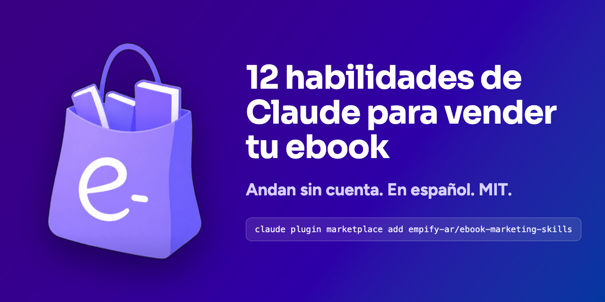

# 12 habilidades de Claude para vender tu ebook. Andan sin cuenta.



De la idea al lanzamiento: elegir la idea, armar el índice, escribir la página de venta, poner precio, pensar los anuncios y planear los 14 días de salida. Si además conectás tu cuenta de [Empify](https://empify.com.ar), una plataforma argentina para crear ebooks y venderlos, tu IA lee tus ventas y tus visitas y te escribe la decisión de la semana. Los cambios los hacés vos.

Abierto (licencia MIT) · en español · sin cuenta para empezar · probado con Claude · [English](README.en.md)

## Instalación

**Claude Code (terminal):**

```bash
claude plugin marketplace add empify-ar/ebook-marketing-skills && claude plugin install empify@empify
```

Después, dentro de Claude Code, escribí `/empify:empezar` (o `/empify:empezar sin cuenta`).

**claude.ai (web y escritorio):**

1. En Ajustes, Capacidades, activá la ejecución de código y creación de archivos (en pantallas nuevas: **Create and edit files**).
2. Bajá un `.zip` de la [última versión](https://github.com/empify-ar/ebook-marketing-skills/releases/latest). Empezá por [`idea-de-ebook.zip`](https://github.com/empify-ar/ebook-marketing-skills/releases/latest/download/idea-de-ebook.zip).
3. En **Personalización** (**Customize**) abrí **Skills**, tocá **+**, **+ Create skill** y **Upload a skill**.
4. Subí un `.zip` por vez.

Más detalle en [docs/instalacion.md](docs/instalacion.md).

## Qué querés, qué escribís, qué recibís

Los siete comandos de Claude Code (con el complemento instalado llevan el prefijo `/empify:`).

| Qué querés | Qué escribís | Qué recibís | ¿Pide cuenta? |
|---|---|---|---|
| Arrancar y saber por dónde seguir | `/empify:empezar` | Tu perfil de vendedor guardado (o un bloque para pegar), el estado de la conexión en una línea y un comando recomendado para seguir | No: con `/empify:empezar sin cuenta` se arma igual |
| Planear el lanzamiento | `/empify:lanzar nombre del ebook` | Un tablero de 14 días con fechas, casillas y criterio para seguir, ajustar o frenar | No; con cuenta parte del estado real de tu tienda |
| Saber cómo viene la semana | `/empify:semana` | Informe de una pantalla: cinco cifras frente a la semana anterior, una observación honesta, una decisión y la fila para tu planilla | Sí |
| Enterarte si algo se rompió | `/empify:guardia` | Revisión corta: tienda pausada o con falla al publicar, Mercado Pago sin conectar, cupo bajo | Sí |
| Elegir qué ebook publicitar | `/empify:elegir` | Tabla de hasta cinco ebooks y una recomendación, diciendo si la muestra alcanza | Sí |
| Textos de anuncio | `/empify:anuncios nombre del ebook` | Al menos tres variantes de gancho, cuerpo y llamado, que difieren en una sola cosa, y una lista de revisión | Sí; la herramienta empieza en el plan Emprendedor |
| Arreglar la conexión | `/empify:doctor` | Veredicto en una línea y pasos para volver a conectar | Sí |

Sin comandos, las habilidades abiertas también se activan solas cuando lo pedís con tus palabras. Por ejemplo: "Tengo dos ideas de ebook, ¿por cuál sigo?", "Armame la estructura de un ebook sobre ahorro para freelancers", "Revisá mi página de venta" o "Armame el plan de 14 días para lanzar mi ebook".

## Así se ve

Esto es lo que entrega el comando `/empify:semana`:

```text
EJEMPLO CON DATOS INVENTADOS, NO ES UNA CUENTA REAL

Datos leídos el lunes 23 de noviembre de 2026 de mi_cuenta, listar_ebooks, ventas y visitas_tienda.
Período: del 16 al 22 de noviembre de 2026.

Estado: plan Emprendedor, Mercado Pago conectado, 2 tiendas publicadas y ninguna con falla.

                        Esta semana              Semana anterior
Visitantes              64                       51
Ventas en pesos         2                        1
Ventas en dólares       0                        0
Conversión (pesos)      sin dato (muestra chica) sin dato
Canal principal         Instagram (38 de 64)     Instagram (30 de 51)

Observación: subieron las visitas y las ventas, pero son números chicos. Pasar de 1 a 2 ventas
no alcanza para decir que algo mejoró. Lo que sí se ve: Instagram trae más de la mitad de las
visitas. Con tan pocas visitas no se puede saber cuál de los dos ebooks pesa más.

Decisión de la semana: publicar tres veces en Instagram con el link de la tienda de "Huerta en
balcón" y no tocar la página. Vuelvo a mirar el lunes 30 con visitantes y ventas, mismo período.

Fila para tu planilla: 2026-11-22 | 64 | 2 | 0 | sin dato | Instagram

Qué no pude saber: cuánto gastaste ni qué resultados tuvieron tus anuncios en Meta; esta
conexión no los ve.
```

Más ejemplos, con un caso inventado de punta a punta (idea, índice, precio, página de venta, anuncios y plan de 14 días): [`ejemplos/`](ejemplos/).

## Las dos partes

Este repositorio tiene dos partes, las dos con licencia MIT.

### Parte 1: doce habilidades que andan sin cuenta

No piden cuenta de Empify, ni conexión, ni ninguna herramienta: alcanza con lo que contás y con las preguntas que te hace tu IA. Sirven para cualquier ebook o producto digital de información, esté donde esté a la venta. Tu IA las lee como texto; no ejecutan código ni mandan datos a ningún lado.

| Habilidad | Para qué sirve |
|---|---|
| [`idea-de-ebook`](skills/idea-de-ebook/SKILL.md) | Dejar la idea en una frase, ver qué ya existe, hacer cinco conversaciones y decidir si seguís, cambiás el recorte o la dejás. |
| [`estructura-de-ebook`](skills/estructura-de-ebook/SKILL.md) | Pasar de la idea al índice: promesa en una frase, capítulos, qué entra y qué no, y un control de calidad antes de escribir. |
| [`ebook-visual`](skills/ebook-visual/SKILL.md) | Armar un ebook donde manda la imagen: plantilla fija, hoja y letra para imprimir, página de muestra y obras de dominio público. |
| [`pagina-de-venta`](skills/pagina-de-venta/SKILL.md) | La estructura de una página que vende y una lista de control, con las frases flojas y su arreglo. |
| [`precio-y-oferta`](skills/precio-y-oferta/SKILL.md) | Elegir precio, bonos y garantía que puedas cumplir, y hacer la cuenta de lo que te queda por venta. |
| [`escalera-de-ofertas`](skills/escalera-de-ofertas/SKILL.md) | Oferta al pagar, oferta después de comprar y segunda oportunidad, con textos, imágenes y una urgencia que sea cierta. |
| [`imagenes-de-venta`](skills/imagenes-de-venta/SKILL.md) | La lista de imágenes que vende un ebook (libro 3D, escena de uso, pantalla de oferta, página de muestra) y cómo pedirlas. |
| [`angulos-de-anuncio-por-fecha`](skills/angulos-de-anuncio-por-fecha/SKILL.md) | Fechas de Argentina y Latinoamérica, ángulos de anuncio por fecha y varias imágenes por ángulo. |
| [`lanzamiento-en-14-dias`](skills/lanzamiento-en-14-dias/SKILL.md) | Un plan día por día alrededor del lanzamiento, con puntos de control. |
| [`piezas-para-redes`](skills/piezas-para-redes/SKILL.md) | Publicaciones para redes sacadas de tu propio libro, fieles a lo que dice, sin pagar anuncios. |
| [`perfil-del-vendedor`](skills/perfil-del-vendedor/SKILL.md) | Un archivo con tu rubro, público, ebooks, canales y meta del mes, que leen las demás habilidades para no repetirte las preguntas. |
| [`proximo-paso`](skills/proximo-paso/SKILL.md) | Tres acciones ordenadas y qué cambió desde la vez anterior. Con cuenta lee tus números; sin cuenta usa los que le contás. |

Ninguna promete ventas, alcance ni resultados: ordenan el trabajo y bajan la incertidumbre.

### Parte 2: lo que suma tu cuenta de Empify

[Empify](https://empify.com.ar) es una plataforma argentina para crear ebooks con IA y venderlos con tienda propia. La cuenta gratis alcanza para empezar. Al conectarla, tu IA puede leer tus ebooks, tus ventas y tus visitas, y las habilidades de esta parte trabajan con tus datos reales. La conexión es una dirección web, `https://empify.com.ar/api/mcp`, no un programa para instalar: los pasos están en [docs/conectar-tu-cuenta.md](docs/conectar-tu-cuenta.md).

| Habilidad | Para qué sirve | Plan de Empify |
|---|---|---|
| [`empify-base`](skills/empify-base/SKILL.md) | Contexto: las 7 herramientas y cuándo usar cada una, permisos, cupos y reglas de seguridad. | Cualquiera |
| [`elegir-idea-con-el-radar`](skills/elegir-idea-con-el-radar/SKILL.md) | Te lleva al Radar de ideas de tu cuenta, explica qué dice y qué no dice cada nivel de competencia y compara las ideas que le pegás. La IA no ve el Radar: trabaja con lo que copiás. Mide anuncios, no ventas. | Cualquiera; con Borrador, las 3 primeras ideas de cada país. No usa la conexión |
| [`validar-idea-de-ebook`](skills/validar-idea-de-ebook/SKILL.md) | Afina la idea con 3 o 4 preguntas, la pone frente a un panel de compradores simulados y cierra con avanzar, ajustar o descartar. Es una simulación: no mide ventas. | Cualquiera; con Borrador, 1 validación por mes. Pide el permiso "crear" |
| [`textos-de-anuncio-para-ebooks`](skills/textos-de-anuncio-para-ebooks/SKILL.md) | Elige ángulo, pide los textos a Empify y los edita, sin promesas ni cifras inventadas. | Emprendedor o superior. Pide el permiso "crear" |
| [`lectura-de-ventas-y-visitas`](skills/lectura-de-ventas-y-visitas/SKILL.md) | Diagnostica si el problema es tráfico o conversión, qué canal rinde y qué hacer esta semana. | Cualquiera; montos, detalle por ebook, origen de visitas y conversión desde Emprendedor |
| [`revision-de-pagina-de-venta`](skills/revision-de-pagina-de-venta/SKILL.md) | Lee tu página de venta como un comprador y devuelve textos para pegar en tu panel. | Cualquiera |
| [`rutina-semanal-del-vendedor`](skills/rutina-semanal-del-vendedor/SKILL.md) | Un repaso de 10 minutos: cuenta, ebooks, ventas, visitas y una decisión. | Cualquiera |
| [`doctor-de-conexion`](skills/doctor-de-conexion/SKILL.md) | Diagnostica por qué no anda la conexión: no agregada, sesión vencida, 30 días sin uso, plan o cupo. | Cualquiera |

Tu IA puede leer tus ebooks, tus ventas, tus visitas y tus cupos, y escribir texto. No puede publicar ni cambiar tu tienda, tocar precios ni cobros, borrar, subir anuncios ni ver datos de tus compradores. El detalle está en [docs/conectar-tu-cuenta.md](docs/conectar-tu-cuenta.md#qué-puede-hacer-tu-ia-con-tu-cuenta); los topes de cada plan, en [docs/limites-por-plan.md](docs/limites-por-plan.md).

Además: los siete comandos de arriba y cuatro [rutinas](#rutinas).

## Plantillas

Están dentro de cada habilidad y se usan desde ahí. Para copiar una, abrila y copiá el texto.

| Plantilla | Para qué | Habilidad |
|---|---|---|
| [Cinco conversaciones](skills/idea-de-ebook/cinco-conversaciones.md) | Mensaje de invitación, preguntas y planilla para probar una idea con cinco personas | `idea-de-ebook` |
| [Control del índice](skills/estructura-de-ebook/control-del-indice.md) | Revisar el índice punto por punto antes de escribir | `estructura-de-ebook` |
| [Ficha de plantilla y derechos](skills/ebook-visual/plantilla-de-pagina.md) | Ficha de la plantilla, prueba de impresión y planilla de derechos de un libro visual | `ebook-visual` |
| [Lista de control de la página](skills/pagina-de-venta/lista-de-control.md) | Revisar una página de venta bloque por bloque | `pagina-de-venta` |
| [Cuenta por venta](skills/precio-y-oferta/cuenta-por-venta.md) | Lo que queda por venta, ventas necesarias y máximo a pagar por venta | `precio-y-oferta` |
| [Textos modelo de ofertas](skills/escalera-de-ofertas/textos-modelo.md) | Textos para la oferta al pagar, después de comprar y la segunda oportunidad | `escalera-de-ofertas` |
| [Pedidos de imágenes](skills/imagenes-de-venta/prompts-por-imagen.md) | Pedidos modelo para un generador de imágenes | `imagenes-de-venta` |
| [Calendario de fechas](skills/angulos-de-anuncio-por-fecha/calendario-de-fechas.md) | Fechas de Argentina y Latinoamérica con su estado y ángulos por fecha | `angulos-de-anuncio-por-fecha` |
| [Planilla de 14 días](skills/lanzamiento-en-14-dias/planilla-de-14-dias.md) | Una fila por día del lanzamiento, con las mismas cinco cifras | `lanzamiento-en-14-dias` |
| [Plantillas para redes](skills/piezas-para-redes/plantillas.md) | Publicaciones sacadas del propio libro | `piezas-para-redes` |
| [Perfil del vendedor](skills/perfil-del-vendedor/plantilla-del-perfil.md) | El archivo que leen las demás habilidades | `perfil-del-vendedor` |
| [Planilla del Radar](skills/elegir-idea-con-el-radar/planilla-del-radar.md) | Comparar ideas copiadas del Radar con lo que sabés y a quién llegás | `elegir-idea-con-el-radar` |
| [Planilla semanal](skills/rutina-semanal-del-vendedor/planilla-semanal.md) | Las cifras de cada semana, siempre con el mismo período | `rutina-semanal-del-vendedor` |
| [Diagnóstico de ventas y visitas](skills/lectura-de-ventas-y-visitas/diagnostico.md) | Resumen de una pantalla y diagnóstico | `lectura-de-ventas-y-visitas` |
| [Lista de chequeo de la página](skills/revision-de-pagina-de-venta/lista-de-chequeo.md) | Revisar la página real de tu tienda | `revision-de-pagina-de-venta` |

Las últimas cuatro son de habilidades de la parte 2. La del Radar necesita tu cuenta para ver las ideas, pero no la conexión; las otras tres rinden más con la cuenta conectada.

## Rutinas

Una rutina es un pedido que tu IA hace sola, en el día y la hora que elegís, y cuyo resultado queda guardado para que lo leas cuando quieras. Hay cuatro (el informe semanal, una guardia diaria, una tanda de anuncios cada 28 días y una para que la conexión no se corte), con el texto para pegar y una guía paso a paso en [`rutinas/LEEME.md`](rutinas/LEEME.md). Corren como tareas programadas de Claude, que piden un plan pago de Claude (Pro, Max, Ultra, Team o Enterprise). Ninguna publica, cambia precios, crea ebooks, sube anuncios ni paga nada.

## Recomendados de otros autores

El catálogo de este repositorio, además de `empify`, lista cuatro complementos de otros autores (`marketing-skills`, `claude-seo`, `claude-ads` y `resend`), cada uno fijado a una versión exacta de su propio repositorio. **No son de Empify ni los respalda su autor.** La tabla con qué hace cada uno, cómo se instala y qué cuidar está en [`RECOMENDADOS.md`](RECOMENDADOS.md), junto con lo que no pudo entrar al catálogo y cinco recetas para combinar tu cuenta de Empify con Canva, Gmail, Google Drive y el conector de anuncios de Meta.

## Qué se probó y qué no

Probado: la conexión con Claude, en español; que el complemento pasa el validador (`claude plugin validate`) y se instala junto con los cuatro recomendados.

Todavía no: las rutinas corriendo solas con la conexión de Empify, y la subida de los `.zip` a claude.ai.

## Más información

- [Instalación en detalle](docs/instalacion.md)
- [Conectar tu cuenta de Empify](docs/conectar-tu-cuenta.md): pasos, qué puede y qué no puede hacer tu IA, pedidos para probar
- [Límites por plan](docs/limites-por-plan.md)
- [Privacidad y seguridad](docs/privacidad-y-seguridad.md)
- [Preguntas frecuentes](docs/preguntas-frecuentes.md)
- [Contenido del repositorio](docs/contenido-del-repositorio.md)
- [Cambios de cada versión](CHANGELOG.md)

## Cómo aportar

Podés pedir una habilidad nueva o avisar de un error desde [Issues](../../issues/new/choose). Si querés proponer un cambio, leé [`CONTRIBUTING.md`](CONTRIBUTING.md). Las reglas que todas las habilidades respetan: sin promesas de ventas ni de ingresos, sin datos inventados (testimonios, cifras, fechas, cupos) y sin urgencia falsa.

## Licencia, marca y contacto

Todo el repositorio está bajo licencia [MIT](LICENSE): podés usarlo, copiarlo, adaptarlo y compartirlo, dejando el aviso de copyright. El nombre y el logo de Empify no quedan cubiertos por la licencia. Los complementos de otros autores que se listan en el catálogo no están en este repositorio y tienen la licencia de cada autor.

Titular: Empify. Contacto: hola@empify.com.ar. Pasos al día y preguntas frecuentes: https://empify.com.ar/conectar-ia
